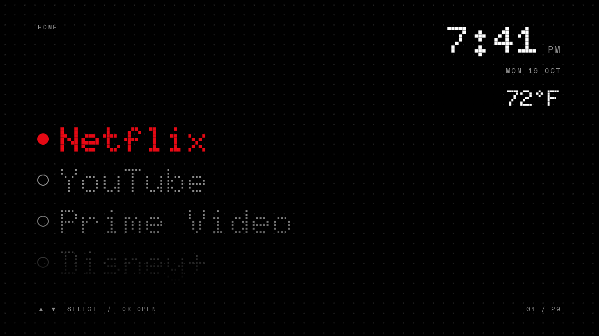
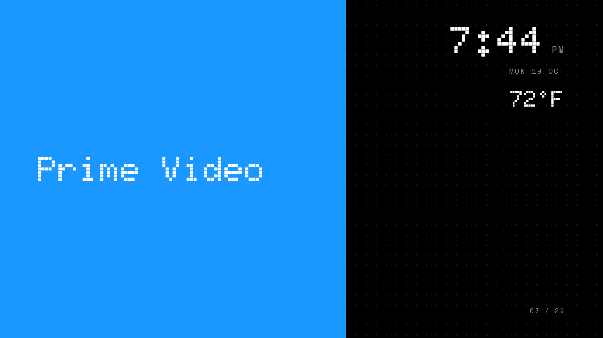

# TV Home

A dot-matrix home screen for Android TV and Google TV, plus scripts to remove bloatware and make it the default Home.
Design is inspired by Nothing's dot-matrix style. It is not affiliated with Nothing, and it uses the open-source
Doto and Space Mono fonts (SIL OFL), downloaded at build time.

## What it does
- Vertical list of your installed TV apps. Up/Down to move, OK to open.
- Clock, date, and outside temperature (Open-Meteo, no API key).
- Color wipe when an app launches.

## Requirements
- An Android TV or Google TV device on the same network as your computer.
- Developer options and USB debugging on (Settings > About, tap the OS build entry 7 times).
- A Mac with Homebrew. The build script installs JDK 17 and the Android SDK if they are missing.

## Setup
1. `cp local.properties.example local.properties` and set `tv.ip`, `tv.lat`, `tv.lon`, `tv.label`.
2. `adb connect <tv ip>:5555` and accept the prompt on the TV.
3. `./build-and-install.sh` builds the APK, installs it, and opens it. It does not change your default Home.

## Make it the default Home
Android only lets a launcher outrank others if it is a system app, so on many TVs the stock launcher must be disabled.
Save your stock home first: `adb shell cmd package resolve-activity --brief -a android.intent.action.MAIN -c android.intent.category.HOME`

    ./set-home.sh                    # disables the stock launcher, sets this one as Home
    ./set-home.sh --with-setupwraith # only if Home still opens Google's setup screen
    ./restore-home.sh                # undo

Package names differ by TV. `set-home.sh` and `restore-home.sh` assume Google TV
(`com.google.android.apps.tv.launcherx`). Check yours with `adb shell pm list packages | grep -i launcher`.
System updates can re-enable the stock launcher. Re-run `./set-home.sh` afterwards.

## Remove bloatware
`debloat.sh` ships with a list written for one TCL Google TV. Treat it as an example and build your own from
`adb shell pm list packages`. It is a dry run by default.

    ./debloat.sh tier1            # dry run
    ./debloat.sh tier1 --apply    # uninstall for user 0 (reversible)
    ./debloat.sh all --restore    # bring everything back

Never remove your stock launcher, Play Store, Google Play services, WebView, package installer, permission controller,
or your vendor's TV input, settings, and system packages. Removing the wrong one can make a TV unusable until a
factory reset. Use at your own risk, one package at a time, and reboot and test after each batch.

## Files
- `app/` Kotlin and Jetpack Compose launcher
- `build-and-install.sh`, `fetch-fonts.sh` build tooling
- `set-home.sh`, `restore-home.sh`, `debloat.sh` TV management over adb
- `local.properties` your private settings, gitignored
